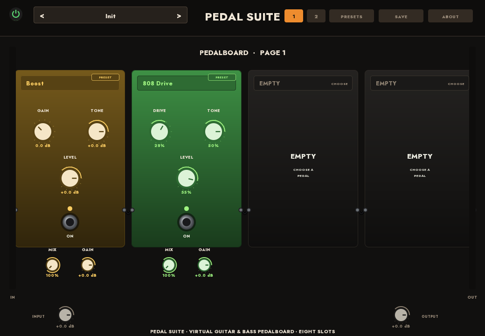
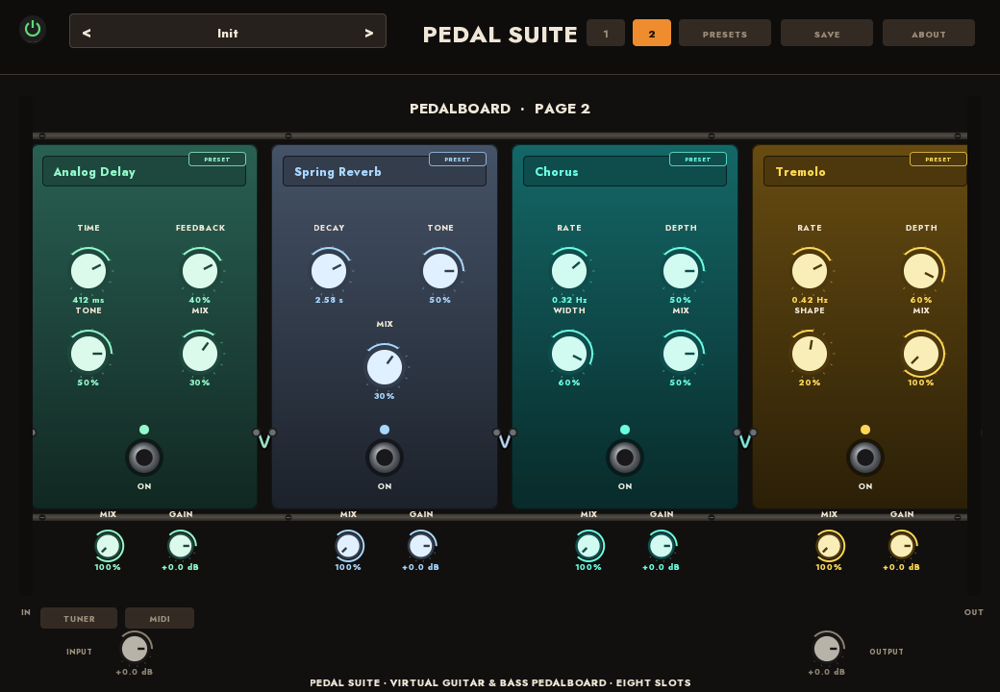
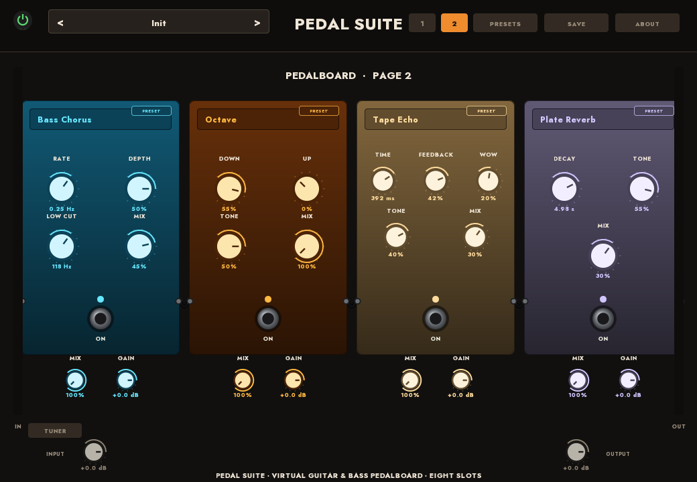
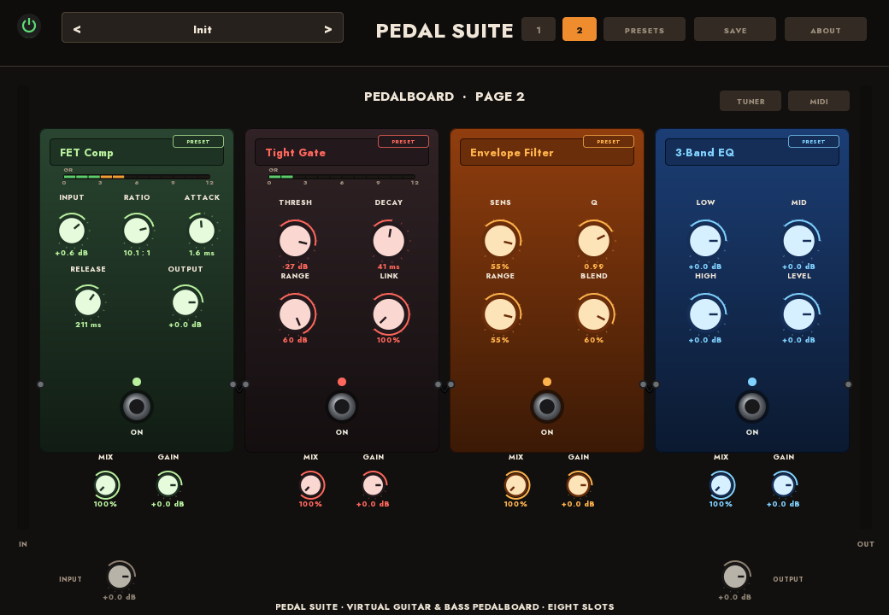
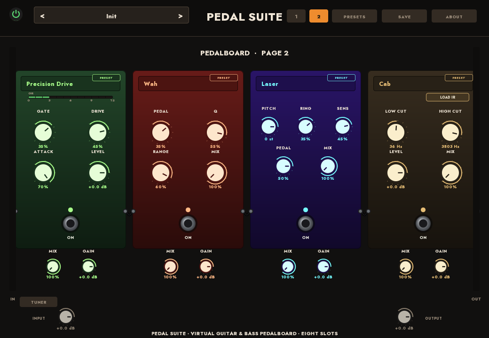

# Pedal Suite

**Status: 0.5.2-alpha — 41 pedals, Cab IR, tuner, boards and MIDI.**

A virtual guitar and bass pedalboard in the Suite visual language: eight pedal
slots across two pages of four, with a shared preset browser, typed values,
drag reordering and host automation.

This is the first P1 slice. It currently ships **Boost** and **808 Drive**
(the retuned Amp Suite TS9/808). The rest of the pedal catalog, pitch engine
and full board visuals land in later milestones.













## Current slice

- 1040×720 panel with power, preset bar, page buttons and utility pills.
- Four wide pedal slots per page; **PAGE 1** = pedals 1–4, **PAGE 2** = 5–8.
- Amp Suite-style pedal cards: gradient faceplates, footswitch, LED, preset button.
- MIX and GAIN sit below each pedal body.
- Drag a pedal name or card to reorder, including page-to-page moves.
- Browser with **ALL / DRIVE / MOD / DYN / TIME / VERB / PRESETS**.
- **Boost** — Gain, Tone, Level.
- **808 Drive** — Drive, Tone, Level; retuned TS9/808 from Amp Suite.
- **Treble Boost** — Boost, Range, Level.
- **Overdrive** — Drive, Tone, Level, Mix.
- **Blues Drive** — Drive, Tone, Level.
- **Distortion** — Dist, Filter, Level.
- **Rat** — Dist, Filter, Level.
- **Big Fuzz** — Sustain, Tone, Level.
- **Fuzz Face** — Fuzz, Bias, Volume.
- **Tone Bender** — Attack, Tone, Level.
- **Bass Drive** — Drive, Blend, Tone, Level.
- **Bass Fuzz** — Fuzz, Blend, Tone, Level.
- **Pitch Drop** — Gojira-style Whammy Up, Whammy Down, Drop, Harmony
  and Detune modes with Pitch, Mode, Glide, Tone and Mix.
- **Retune** — Low-latency semitone/cent tuning with Semitones, Cents,
  Low Cut and Mix.
- **Chorus** — Rate, Depth, Width, Mix.
- **Flanger** — Rate, Depth, Feedback, Mix.
- **Phaser** — Rate, Depth, Feedback, Mix.
- **Tremolo** — Rate, Depth, Shape, Mix.
- **Analog Delay** — Time, Feedback, Tone, Mix.
- **Spring Reverb** — Decay, Tone, Mix.
- **Bass Chorus** — Rate, Depth, Low Cut, Mix.
- **Vibrato** — Rate, Depth, Mix.
- **Octave** — Down, Up, Tone, Mix.
- **Tape Echo** — Time, Feedback, Wow, Tone, Mix.
- **Digital Delay** — Time, Feedback, Tone, Mix.
- **Ping-Pong** — Time, Feedback, Tone, Mix.
- **Plate Reverb** — Decay, Tone, Mix.
- **Room Reverb** — Decay, Tone, Mix.
- **FET Comp** — Input, Ratio, Attack, Release, Output.
- **Opto Comp** — Peak, Gain, Mix.
- **Envelope Filter** — Sens, Q, Range, Blend.
- **Noise Gate** — Threshold, Decay, Range.
- **Tight Gate** — Threshold, Decay, Range, Link.
- **3-Band EQ** — Low, Mid, High, Level.
- **Bass EQ** — Low, Mid, High, Level.
- **Lo-Fi** — Bits, Rate, Tone, Mix.
- **Tape Sat** — Drive, Tone, Mix.
- **Precision Drive** — Gate, Drive, Attack, Level.
- **Wah** — Pedal, Q, Range, Mix.
- **Laser** — Pitch, Ring, Sens, Pedal, Mix.
- **Cab** — Low Cut, High Cut, Level, Mix, with user WAV IRs.

Compressors and gates report gain reduction to the pedals, the CLAP host and
the LV2 `slotN_gr` ports. Delay and reverb tails keep ringing when bypassed.

The **TUNER** button opens a monophonic tuner fed from the dry input, with
note, octave, cents, frequency and confidence.

**MIDI footswitch:** notes 36–43 or 60–67, and CC 20–27 or 80–87, toggle
pedals 1–8. CC 4 or 11 drives the first Wah pedal. Both CLAP and LV2 accept
the events.

**Cab IRs:** drop 16/24/32-bit or float WAV files in
`~/.local/share/pedal-suite/irs` (or `$XDG_DATA_HOME/pedal-suite/irs`), then
use the **IR** button on the Cab pedal. IRs are rescanned when the plugin is
loaded, so reload after adding files.

Twelve board presets ship ready to play, including Clean Platform, 808 Stack,
Lead Lift, Ambient Wash, Gojira Drop, Bass Growl, Funk Wah, Pitch Lead,
Spring Surf, Lo-Fi Tape and Modern Metal.
- Factory board presets: Clean Platform, 808 Stack, Lead Lift.
- User board and pedal presets: save, rename and delete.
- Double-click resets a knob; right-click types an exact value.
- CLAP and LV2 builds share state, automation, latency and GR plumbing.

## Repository layout

```
pedal-suite
├── src/                    plugin container, UI, engine and metadata
├── third_party/hearth-dsp  shared DSP primitives
├── third_party/pedal-dsp   pedal-specific DSP
├── tools/gen_ttl.cpp       LV2 metadata generator
└── test/                   DSP, state and panel tests
```

## Build

```sh
git submodule update --init --recursive
cmake -S . -B build -DCMAKE_BUILD_TYPE=Release
cmake --build build -j
ctest --test-dir build --output-on-failure
```

## Install

CLAP:

```sh
cp build/clap/PedalSuite.clap ~/.clap/
cp -r build/clap/PedalSuite.resources ~/.clap/
```

LV2:

```sh
cp -r build/lv2/pedal-suite.lv2 ~/.lv2/
```

## Roadmap

1. Pedalboard visuals: LEDs, footswitch caps, patch cables.
2. Pitch Drop and low-latency Retune.
3. Drive/fuzz family, then modulation, time, reverb, dynamics.
4. Full preset catalog and public alpha.

GPL-3.0-or-later.
