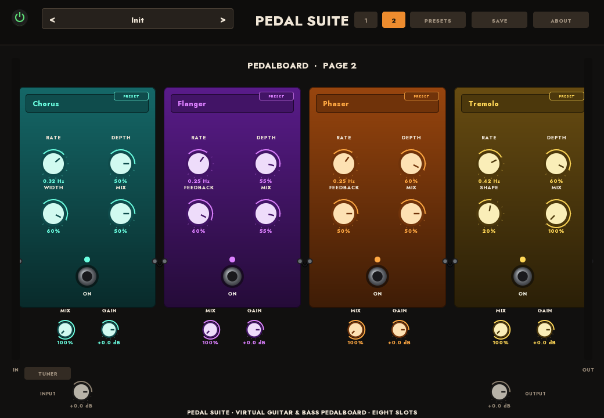
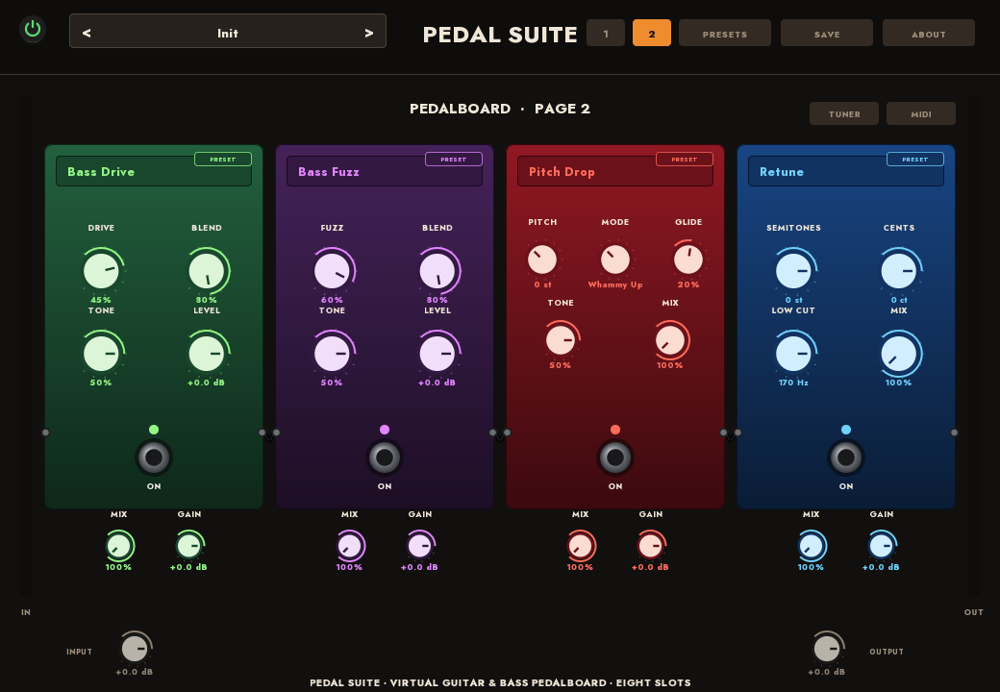
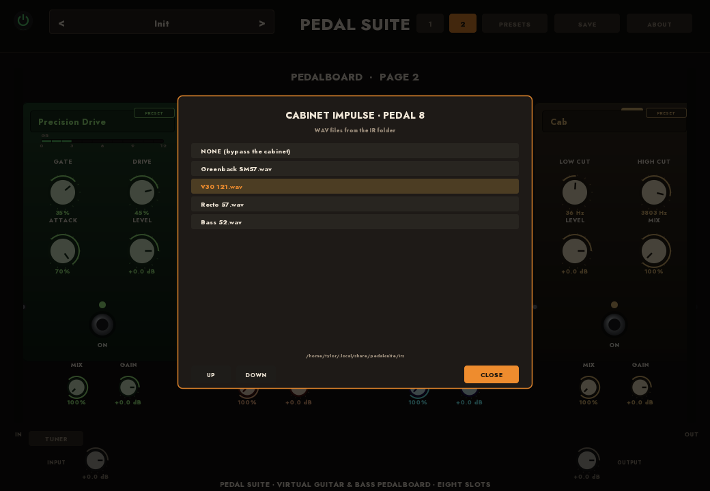
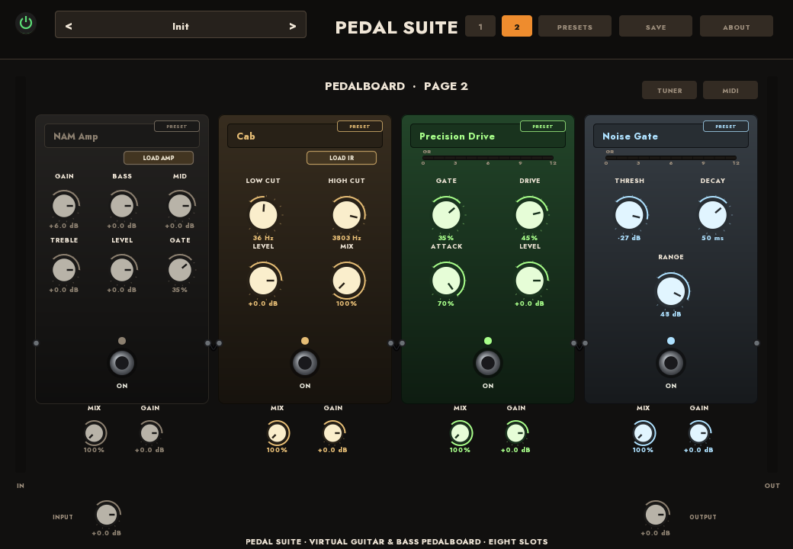
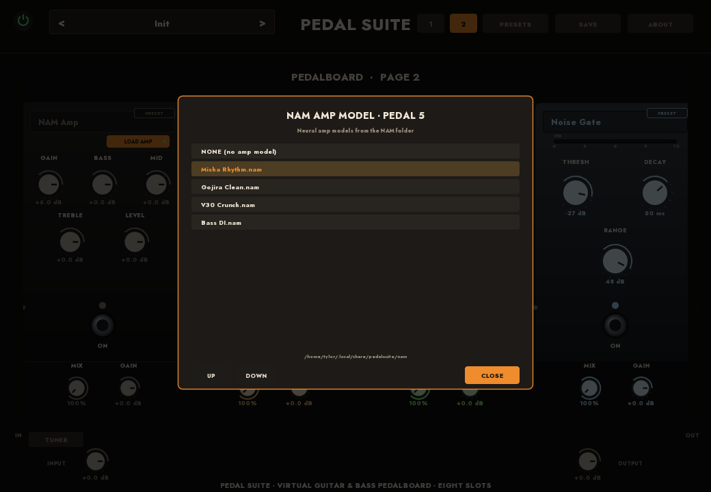
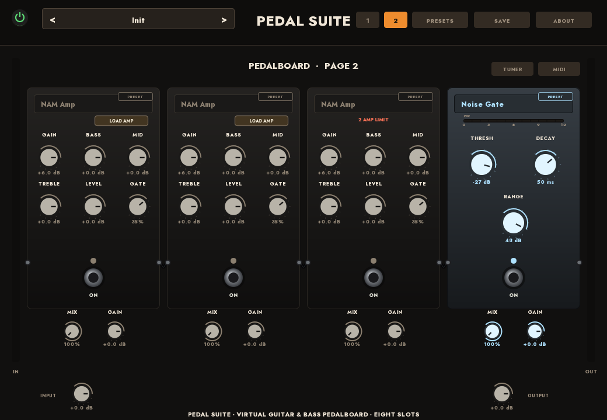
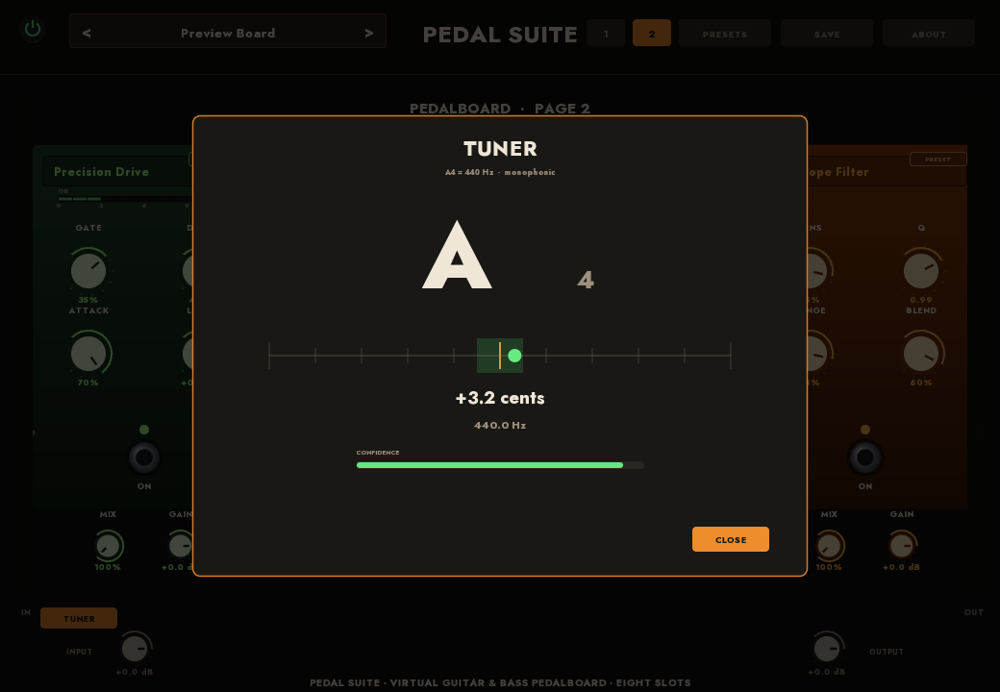
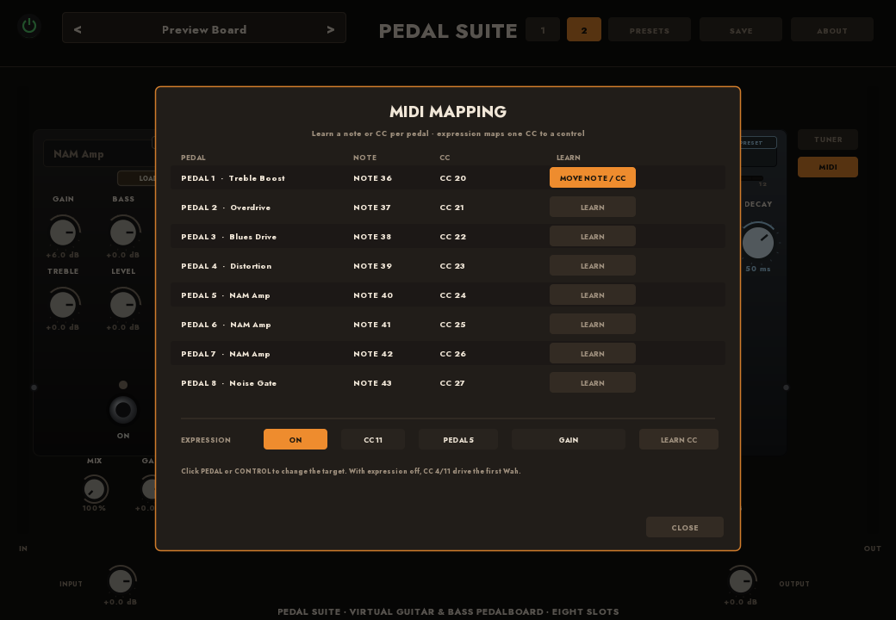
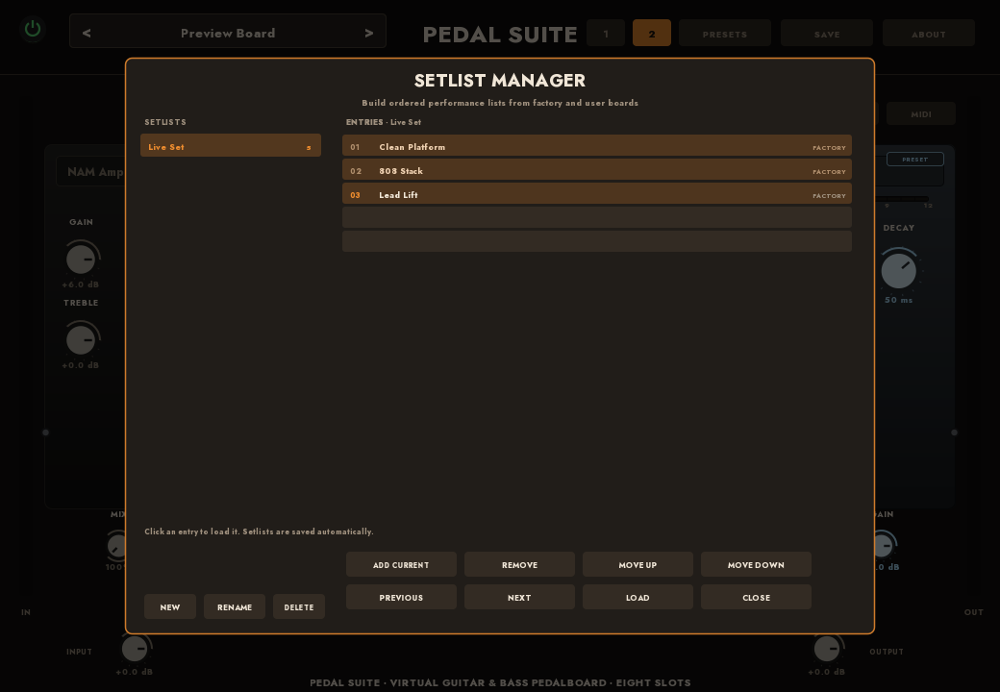

# Pedal Suite

**Status: 0.8.9-alpha — 43 pedals, FFT Cab, NAM, tuner, MIDI learn, banks and setlists.**

A virtual guitar and bass pedalboard in the Suite visual language: eight pedal
slots across two pages of four, with a shared preset browser, typed values,
drag reordering and host automation.

The full pedal catalog is in place: drive and fuzz, pitch and retune,
modulation, time, reverb, dynamics, utility pedals, FFT cab IRs, NAM, a
monophonic tuner and MIDI learn/expression mapping.





















## Current slice

- 1040×720 panel with power, preset bar, page buttons and utility pills.
- Four wide pedal slots per page; **PAGE 1** = pedals 1–4, **PAGE 2** = 5–8.
- Amp Suite-style pedal cards: gradient faceplates, footswitch, LED, preset button.
- MIX and GAIN sit below each pedal body.
- Drag a pedal name or card to reorder, including page-to-page moves.
- Browser with **ALL / DRIVE / MOD / DYN / TIME / UTIL / AMP / PRESETS**.
- Board preset banks: **ALL**, each factory category and **USER**.
- Setlist manager for ordered live performance lists.
- **Boost** — Gain, Tone, Level.
- **808 Drive** — Drive, Tone, Level; retuned TS9/808 from Amp Suite.
- **Treble Boost** — Boost, Range, Level.
- **Overdrive** — Drive, Tone, Level, Mix.
- **Blues Drive** — Drive, Tone, Level.
- **Distortion** — Dist, Filter, Level.
- **Rat** — Dist, Filter, Level.
- **Big Fuzz** — Sustain, Tone, Level.
- **Fuzz Face** — Fuzz, Bias, Volume.
- **Tone Bender** — Attack, Tone, Level.
- **Bass Drive** — Drive, Blend, Tone, Level.
- **Bass Fuzz** — Fuzz, Blend, Tone, Level.
- **Pitch Drop** — Gojira-style Whammy Up, Whammy Down, Drop, Harmony
  and Detune modes with Pitch, Mode, Glide, Tone and Mix; 20 ms latency.
- **Retune** — Low-latency (20 ms) semitone/cent tuning with Semitones, Cents,
  Low Cut and Mix.
- **Chorus** — Rate, Depth, Width, Mix.
- **Flanger** — Rate, Depth, Feedback, Mix.
- **Phaser** — Rate, Depth, Feedback, Mix.
- **Tremolo** — Rate, Depth, Shape, Mix.
- **Analog Delay** — Time, Feedback, Tone, Mix.
- **Spring Reverb** — Decay, Tone, Mix.
- **Bass Chorus** — Rate, Depth, Low Cut, Mix.
- **Vibrato** — Rate, Depth, Mix.
- **Octave** — Down, Up, Tone, Mix.
- **Tape Echo** — Time, Feedback, Wow, Tone, Mix.
- **Digital Delay** — Time, Feedback, Tone, Mix.
- **Ping-Pong** — Time, Feedback, Tone, Mix.
- **Plate Reverb** — Decay, Tone, Mix.
- **Room Reverb** — Decay, Tone, Mix.
- **FET Comp** — Input, Ratio, Attack, Release, Output.
- **Opto Comp** — Peak, Gain, Mix.
- **Envelope Filter** — Sens, Q, Range, Blend.
- **Auto-Wah** — Sens, Q, Range, Mix; vocal envelope sweep that opens with picking attack.
- **Noise Gate** — Threshold, Decay, Range.
- **Tight Gate** — Threshold, Decay, Range, Link.
- **3-Band EQ** — Low, Mid, High, Level.
- **Bass EQ** — Low, Mid, High, Level.
- **Lo-Fi** — Bits, Rate, Tone, Mix.
- **Tape Sat** — Drive, Tone, Mix.
- **Precision Drive** — Gate, Drive, Attack, Level.
- **Wah** — Pedal, Q, Range, Mix.
- **Laser** — Pitch, Ring, Sens, Pedal, Mix.
- **Cab** — Low Cut, High Cut, Level, Mix, with user WAV IRs. Two live cabs max; FFT convolution adds 256 samples of reported latency.
- **NAM Amp** — Gain, Bass, Mid, Treble, Level, Gate, with Neural Amp Modeler `.nam` files. Find it under the **AMP** browser page. The gate mutes captured amp hiss so later gain blocks stay quiet.

Compressors and gates report gain reduction to the pedals, the CLAP host and
the LV2 `slotN_gr` ports. Delay and reverb tails keep ringing when bypassed.

The **TUNER** button opens a monophonic tuner fed from the dry input, with
note, octave, cents, frequency and confidence.

**MIDI footswitch:** notes 36–43 or 60–67, and CC 20–27 or 80–87, toggle
pedals 1–8. CC 4 or 11 drives the first Wah pedal. Both CLAP and LV2 accept
the events.

**Banks and setlists:** the board preset browser has a **BANK** filter that
cycles through ALL, each factory category and USER. **SETLIST** opens the
setlist manager: create, rename and delete lists; add the current board
(captured as a snapshot, including unsaved edits); reorder entries; step with
PREVIOUS/NEXT; and click an entry to load it.
Setlists are stored in `~/.config/PedalSuite/setlists` and survive sessions.

**Performance MIDI:** **CC 28 / 29** step to the previous / next setlist entry,
**CC 30 / 31** move to the previous / next preset bank, and **Program Change**
selects an entry in the active setlist. With no active setlist, Program Change
selects a preset within the current bank. CC 28–31 are reserved for these
performance controls.

In both **CLAP and LV2**, setlist and bank MIDI continue working with the
editor closed. The plugin keeps a preloaded performance copy and reloads it
when the editor closes; the editor and plugin exchange performance position
so reopening the window resumes from the same bank and entry.

**MIDI learn and expression:** open the **MIDI** button in the footer, then
click **LEARN** on a pedal and send the note or CC you want. Each pedal stores
its own note and CC. **LEARN CC** in the expression row captures a continuous
controller, and the PEDAL / CONTROL pills choose which loaded pedal control it
drives. Mappings are stored with the plugin state, so they survive sessions and
presets.

**NAM amps:** drop `.nam` files in `~/.local/share/pedal-suite/nam` (or
`$XDG_DATA_HOME/pedal-suite/nam`), then use **LOAD AMP**. Only **two** NAM
blocks run per session; further NAM pedals pass dry and show a limit warning.
Models are resampled to the host rate, DC-blocked, and add 64 samples of
reported latency.

The browser now has **ALL · DRIVE · MOD · DYN · TIME · UTIL · AMP · PRESETS**:
utility pedals and the Cab live in UTIL, the NAM Amp lives in AMP.

**Cab IRs:** up to two live Cab pedals. Drop 16/24/32-bit or float WAV files in
`~/.local/share/pedal-suite/irs` (or `$XDG_DATA_HOME/pedal-suite/irs`), then
use the **IR** button on the Cab pedal. IRs are rescanned when the plugin is
loaded, so reload after adding files.

Twenty-eight board presets ship ready to play, including Clean Platform, 808
Stack, Lead Lift, Ambient Wash, Gojira Drop, Bass Growl, Funk Wah, Pitch Lead,
Spring Surf, Lo-Fi Tape, Modern Metal, Classic Rock, Bluesbreaker, Country
Twang, Shoegaze, Funk Machine, Bass DI, Synth Bass, Prog Lead, Worship, Garage,
Doom and Acoustic DI.
- Factory board presets: 28 across clean, drive, rock, blues, country, funk,
  metal, bass, ambient, prog, worship, garage and acoustic categories.
- User board and pedal presets: save, rename and delete.
- Double-click resets a knob; right-click types an exact value.
- CLAP and LV2 builds share state, automation, latency and GR plumbing.

## Repository layout

```
pedal-suite
├── src/                    plugin container, UI, engine and metadata
├── third_party/hearth-dsp  shared DSP primitives
├── third_party/pedal-dsp   pedal-specific DSP
├── tools/gen_ttl.cpp       LV2 metadata generator
└── test/                   DSP, state and panel tests
```

## Build

```sh
git submodule update --init --recursive
cmake -S . -B build -DCMAKE_BUILD_TYPE=Release
cmake --build build -j
ctest --test-dir build --output-on-failure
```

## Install

CLAP:

```sh
cp build/clap/PedalSuite.clap ~/.clap/
cp -r build/clap/PedalSuite.resources ~/.clap/
```

LV2:

```sh
cp -r build/lv2/pedal-suite.lv2 ~/.lv2/
```

## Roadmap

1. More pedal models and artist-style capture/IR packs.
2. More factory preset packs and artist-style boards.
3. macOS / Windows and VST3/AU packaging.
4. Public beta polish and wider listening tests.

GPL-3.0-or-later.
